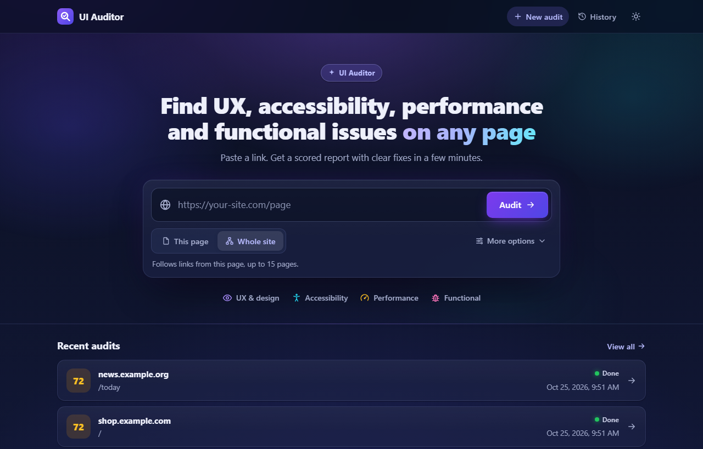
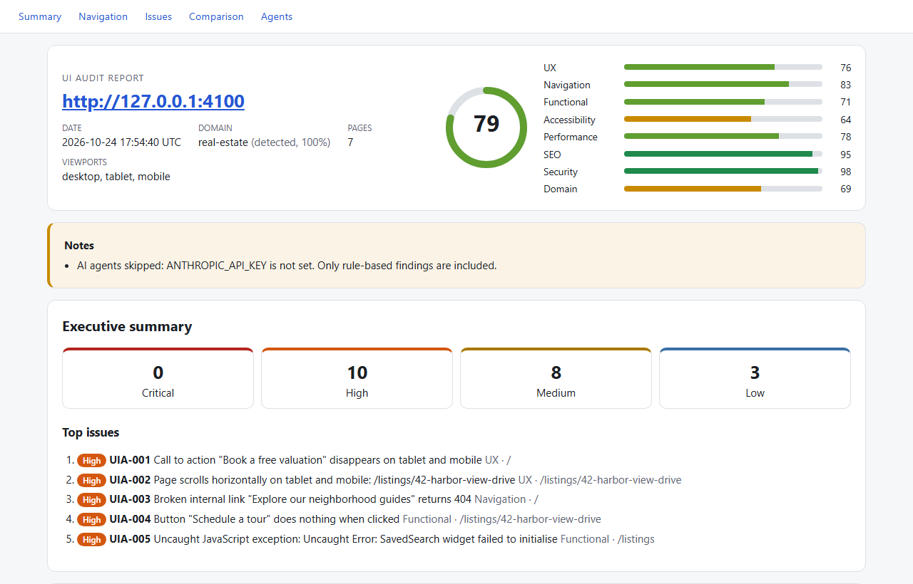
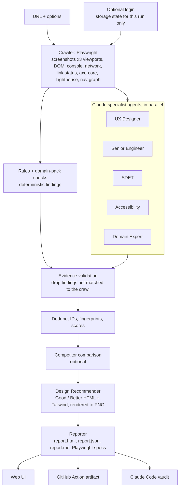

# UI Auditor

**Paste one URL, get an evidence-backed UX, engineering, SDET, accessibility and domain audit, with "Good" and "Better" redesigns for the worst problems.**

UI Auditor crawls a site with Playwright, collects hard evidence (screenshots at three viewports, DOM, console and network logs, link status, axe-core, Lighthouse), then has Claude specialist agents review that evidence from different expert points of view. Every finding cites evidence from the crawl; findings that don't are dropped.

| Persona | What it looks for |
|---|---|
| **UX Designer** | Visual hierarchy, consistency, readability, clarity of calls to action, Nielsen heuristics, mobile layout, empty/error states |
| **Senior Software Engineer** | Console errors, failed network calls, slow pages (Core Web Vitals), semantic HTML, SEO basics, security headers, broken assets |
| **SDET** | Broken links, dead buttons, forms that don't validate, navigation dead ends, responsive breakage, repeatable Playwright tests |
| **Domain Expert** (auto-detected) | Industry patterns the site is missing, e.g. for real estate: listing filters, map search, photo gallery, mortgage calculator, "contact agent" CTA |

An **Accessibility** agent (axe-core results plus a WCAG 2.2 AA review) runs alongside them, and a **Design Recommender** turns the top issues into rendered HTML mockups.




See a [sample report](docs/sample-report/report.html): a real run against the bundled fixture site, rule-based only (no API key).

## Quick start

Requires Node.js 22.19 or newer.

```bash
git clone https://github.com/suneelasree/ui-auditor.git
cd ui-auditor
npm ci
npx playwright install chromium
cp .env.example .env        # then set ANTHROPIC_API_KEY
npm start                   # builds the UI and serves http://localhost:3000
```

Without `ANTHROPIC_API_KEY` (empty by default in `.env.example`; the `your-...` placeholder also counts as unset) the audit still runs and produces rule-based findings (broken links, axe violations, console errors, missing H1, and so on); the AI agents and design alternatives are skipped and the report says so.

For development, `npm run dev` runs the server in watch mode with the Vite dev server.

The Web UI answers only on `localhost` / `127.0.0.1`. To reach it under another host name, list it in `UIA_ALLOWED_HOSTS` (comma-separated).

## Using the Web UI

1. Open `http://localhost:3000`, paste a URL, choose **This page** or **Whole site**, and click **Audit**. Everything else is under **More options**.
2. If the page needs a sign-in, click **Sign in**: a browser window opens and you sign in as you normally do. The audit starts by itself once you're in (see [Logged-in pages](#logged-in-pages)).
3. Watch live progress per stage and per agent (crawl, rules, each specialist, competitors, design, report).
4. Open the report when it finishes. Past runs are listed from `reports/` and can be reopened at any time.
5. Optionally select findings and export them to GitHub Issues or Jira (see [Issue export](#issue-export)).

## Options

The same options are available in the Web UI, the GitHub Action and the internal `npm run audit` script.

| Option | Web UI | `npm run audit` flag | Default | Notes |
|---|---|---|---|---|
| URL | URL field | positional argument (may follow `--`) | required | Site to audit |
| Depth | Depth | `--depth <n>` | `2` | Link depth from the start URL (0-5) |
| Max pages | Max pages | `--max-pages <n>` | `15` | Same-origin pages only (1-100) |
| Domain | Domain | `--domain <name>` | `auto` | `auto`, `real-estate`, `ecommerce`, `saas`, `healthcare`, `banking`, `travel`, `education`, `generic` |
| Viewports | Viewports | `--viewports desktop,tablet,mobile` | all three | 1440x900, 768x1024, 375x812 |
| Competitors | Competitor URLs | `--competitor <url>` (repeatable, or comma-separated) | none | Up to 2 |
| Allow forms | Allow forms | `--allow-forms` | off | Read-only unless on; when on, forms may be submitted empty to test validation |
| Lighthouse | Lighthouse | `--no-lighthouse` | on | Turn off to speed up runs |
| Login | Login section | `--login-url <url>` | off | See [Logged-in pages](#logged-in-pages) |
| After login, choose | After login, choose (optional) | `--login-choose <text>` (repeatable) | none | Tenant/workspace picker choices, in order |
| Login success check | Login section | `--login-success-url <text>`, `--login-success-selector <css>` | none | URL fragment or visible element that confirms login |
| Output folder | n/a | `--out <dir>` | `./reports` | |

Safe defaults: read-only, same-origin crawl, respects `robots.txt`, rate limited, logout links skipped.

`npm run audit -- <url> [options]` is an **internal** headless runner used by the GitHub Action and Claude Code. It is not a published CLI. It writes `reports/<runId>/` and exits with code 0 on success, 1 if the audit fails, 2 on invalid options. The URL can also come last after `--` (`npm run audit -- [options] -- <url>`), which is how the GitHub workflow calls it.

```bash
npm run audit -- https://staging.example.com --max-pages 10 --domain ecommerce --competitor https://competitor.example
```

## Logged-in pages

### In the Web UI: sign in yourself, once

When you click **Audit**, UI Auditor first checks whether the page shows a sign-in form. If it does:

1. Click **Sign in**. A normal browser window opens at that page.
2. Sign in exactly as you usually do: password, Microsoft/SSO, MFA, tenant or workspace pickers all work, because it's you doing it. UI Auditor never sees your password.
3. As soon as the sign-in form is gone, UI Auditor saves the session for that site, closes the window and starts the audit. If detection is slow, click **I'm signed in**.

The session (cookies and local storage) is saved in `.auth/sessions/` (git-ignored) and reused for later audits of the same site until it expires. Click **Forget** next to the site on the home page to delete it. Treat that folder like a password: anyone with the file can act as you on that site until the session expires. The API is described in [docs/SIGNIN_API.md](docs/SIGNIN_API.md).

### In CI and the headless script: username and password

Use **test or staging accounts only.** MFA, CAPTCHA and SSO are not supported here.

- Credentials come from `UIA_LOGIN_USER` and `UIA_LOGIN_PASSWORD` (environment, `.env`, or GitHub secrets). The Web UI API still accepts them for a single run (held in memory only), but the Web UI itself uses the sign-in window above.
- Give a login URL. Username/password fields and the submit button are auto-detected. A success check (URL fragment or visible element) can be set with `--login-success-url` / `--login-success-selector`. The login waits up to 20 seconds for single-page-app sign-in forms to appear.
- **After login, choose** (`--login-choose`, repeatable): for tenant or workspace pickers. Each choice selects a matching `<select>` option, clicks a CSS selector, or clicks a button/option/link whose text matches (exact match first, then contains). If the choice appears on the sign-in form itself, the sign-in button is pressed again afterwards.
- If login fails, the error says what the page showed and a screenshot is saved to `evidence/login-failed.png` (password fields masked).
- After login, the browser session is saved as a Playwright storage state for that run only and deleted when the run ends.
- Password fields are masked in screenshots; nothing else is. A page that shows the logged-in username or email will show it in screenshots. Credentials are redacted from logs and never appear in reports.
- Logout links are excluded from the crawl so the session survives.
- Lighthouse runs in a separate browser without the login session, so logged-in-only pages may have no Lighthouse data.

```bash
UIA_LOGIN_USER=qa-bot UIA_LOGIN_PASSWORD=... npm run audit -- --login-url https://staging.example.com/login --login-choose "Acme QA" -- https://staging.example.com
```

## Competitor comparison

Add up to two competitor URLs. Each competitor gets a quick crawl (home page plus up to 5 linked pages; public, no login, desktop only, rules and domain-pack checks only) and is scored with the same categories. For a like-for-like comparison the target is re-crawled the same way and those scores are compared; the full audit score elsewhere in the report is unchanged. The report then includes a **Comparison** section: side-by-side scores, what they do better (with screenshots), where you win, and patterns worth copying. Competitor findings are never exportable.

## Issue export

Export is available **only in the Web UI** and is never automatic.

1. In a report, select findings and click **Export**, then choose GitHub Issues or Jira.
2. A preview shows exactly what will be created: title, description (repro steps, expected/actual, evidence), priority mapped from severity, labels and screenshot attachments.
3. Nothing is sent until you confirm.

Configure targets in `.env`:

| Target | Variables |
|---|---|
| GitHub Issues | `GITHUB_TOKEN` (fine-grained token with Issues read/write on the repo), `GITHUB_REPO` (`owner/repo`) |
| Jira | `JIRA_BASE_URL`, `JIRA_EMAIL`, `JIRA_API_TOKEN`, `JIRA_PROJECT_KEY`, `JIRA_ISSUE_TYPE` (default `Bug`), `JIRA_SET_PRIORITY` (default `true`; set `false` if your project rejects priority on create) |

Each finding has a stable fingerprint (it includes the page URL's query string, so `/listing?id=1` and `/listing?id=2` are distinct). Exported fingerprints are recorded in `reports/exports.json`; already-exported findings are marked in the UI and skipped on re-export.

## GitHub Action

`.github/workflows/ui-audit.yml` runs an audit and uploads `reports/` as the `ui-audit-report` artifact. The top of `report.md` is also written to the job summary. It never exports issues.

**Manual run:** Actions tab, **UI Audit**, **Run workflow**.

| Input | Required | Default | Description |
|---|---|---|---|
| `url` | yes | | URL to audit |
| `competitors` | no | | Comma-separated competitor URLs (max 2) |
| `domain` | no | `auto` | Domain pack |
| `max_pages` | no | `15` | Page cap |
| `login_url` | no | | Login URL; uses the login secrets |

**Secrets** (Settings, Secrets and variables, Actions):

| Secret | Required | Purpose |
|---|---|---|
| `ANTHROPIC_API_KEY` | recommended | AI agents and designs; without it only rule-based findings are produced |
| `UIA_LOGIN_USER`, `UIA_LOGIN_PASSWORD` | only with `login_url` | Test/staging account |

**Reusable workflow:** call it from another workflow, for example against a staging deploy on every PR:

```yaml
jobs:
  audit:
    uses: suneelasree/ui-auditor/.github/workflows/ui-audit.yml@main
    with:
      url: https://staging.example.com
      max_pages: '10'
      auditor_repository: suneelasree/ui-auditor   # needed when calling from a different repository
    secrets:
      ANTHROPIC_API_KEY: ${{ secrets.ANTHROPIC_API_KEY }}
```

Inputs are passed to the audit script through environment variables, never interpolated into shell code.

## Claude Code `/audit`

This repo ships a Claude Code slash command and subagents:

- `.claude/commands/audit.md`: `/audit <url> [options]`
- `.claude/agents/`: `ux-designer`, `senior-engineer`, `sdet`, `accessibility`, `domain-expert`, `design-recommender`

Open the repo in Claude Code and run, for example:

```
/audit https://staging.example.com --max-pages 10 --competitor https://competitor.example
```

The command runs `npm run audit` with your arguments, reads `report.json`, asks the subagents (in parallel) for a deeper review of the collected evidence, and summarizes the top issues with the path to `report.html`. Each subagent writes `reports/<runId>/claude-review-<agent>.md`. `/audit` never exports issues.

## Architecture



See [docs/ARCHITECTURE.md](docs/ARCHITECTURE.md) for the module map and run-folder layout.

## Report contents

Each run writes `reports/<runId>/`:

- `report.html`: self-contained, opens without the server. Executive summary (overall and per-category scores 0-100, top 5 issues), navigation map with dead ends and orphan pages, filterable issues table with evidence crops, Original/Good/Better design comparisons, domain insights, competitor comparison.
- `report.json`: machine-readable report (schema: `Report` in `src/core/types.ts`).
- `report.md`: pasteable into GitHub issues, Jira or PR comments.
- `tests/generated/*.spec.ts`: Playwright regression specs for functional defects; they fail until the defects are fixed.
- `evidence/`: screenshots, crops, DOM snapshots and design mockups.

Every finding has: ID (`UIA-012`), title, category (UX, Navigation, Functional, Accessibility, Performance, SEO, Security, Domain), severity (Critical, High, Medium, Low), found by, page and viewport, evidence, steps to reproduce, expected vs actual, recommendation, and a design alternative for top issues.

## Domain packs

Domain packs are YAML checklists in `domains/`. The domain is detected from page content (keyword hits across crawled text) and can be overridden with the Domain option.

Shipped packs: `real-estate`, `ecommerce`, `saas`, `healthcare`, `banking`, `travel`, `education`, `generic` (fallback heuristics only).

### Adding a domain pack

1. Create `domains/<name>.yaml`:

   ```yaml
   name: automotive
   displayName: Automotive dealer
   detect:
     keywords: [test drive, inventory, financing, trade-in, mileage, dealer]
     minScore: 4          # minimum keyword hits across crawled pages
   checks:
     - id: auto-inventory-filters
       title: Inventory filters
       description: Shoppers filter by make, model, price and mileage.
       severity: High     # Critical | High | Medium | Low
       signals:           # present if ANY selector matches or ANY keyword appears on ANY page
         selectors: ['select[name*="make" i]', '[data-filter="price"]']
         keywords: [filter by make, price range]
       recommendation: Add make, model, price and mileage filters above the results.
       positive: Inventory filters   # optional: the pattern phrased positively, used in competitor comparisons
   ```

   `positive` defaults to the title without a leading "No".

2. Add the name to `DOMAIN_NAMES` in `src/core/types.ts` (the pack is validated by the `DomainPack` zod schema, and `name` must be one of these).
3. Add it to the Domain option list in the Web UI if it is not generated from `DOMAIN_NAMES`, and to the `domain` input description in `.github/workflows/ui-audit.yml`.
4. Run `npm test`; the domain-pack schema test loads and validates every pack.

## Development and testing

```bash
npm run lint         # ESLint (flat config)
npm run typecheck    # tsc --noEmit
npm test             # Vitest unit + integration, then Playwright e2e of the Web UI
npm run fixtures     # serve the fixture sites on http://localhost:4100 and http://localhost:4200
```

`fixtures/real-estate-site/` is a local site with seeded defects (broken link, dead button, missing alt text, low contrast, CTA hidden on mobile, console error, 404 image, form without validation, nav dead end, missing price filter, oversized image, missing H1, and a login-protected page with its own defect). They are documented in `fixtures/real-estate-site/SEEDED_DEFECTS.md`. `fixtures/competitor-site/` does several things better and is used for comparison tests.

Integration tests check that the crawler finds every deterministic seeded defect, that login reaches the protected page, that the test password appears nowhere in the outputs, and that export sends nothing before confirmation (Jira, GitHub and Claude are mocked).

See [CONTRIBUTING.md](CONTRIBUTING.md).

## Cost notes

- Only evidence goes to Claude: viewport-sized above-the-fold screenshots and element crops (never full-page captures), plus trimmed DOM/text samples, batched per page. Images are not downscaled; any over 8000px on a side or 5 MB are skipped with a note.
- Pages are capped (`--max-pages`, default 15); competitors get at most 6 pages each. Lighthouse runs on at most the first 5 pages.
- The model is set by `UIA_MODEL` (default `claude-opus-5-5`) and effort by `UIA_EFFORT` (`low` to `max`, default `high`; invalid values fall back to `high`). For cheaper runs set `UIA_MODEL` to a Sonnet model and/or lower `UIA_EFFORT`.
- `--no-lighthouse` and fewer viewports make runs faster (Lighthouse and screenshots are local, not billed).

## Limitations

- No public CLI; `npm run audit` is internal.
- No MFA, CAPTCHA or SSO login.
- Only password inputs are masked in screenshots; a logged-in username or email shown on the page will appear in screenshots.
- Lighthouse covers at most the first 5 pages and runs without the login session.
- No penetration or security testing beyond passive header checks.
- No crawling across domains; competitors are separate, limited crawls.
- Not a hosted, multi-user service; it runs locally or in your CI.
- No automatic issue creation; export always needs a preview and confirmation in the Web UI.
- AI findings are only as good as the evidence: anything not visible in the crawl (e.g. behind interactions the crawler doesn't perform) is out of scope.

Only audit sites you are authorized to test. See [SECURITY.md](SECURITY.md).

## License

[MIT](LICENSE)
